# 玖伴（Everpal）：流程 · 思维导图 · 架构图

> 依据 `docs/PRD.md`。产品名 **玖伴** / **Everpal**（九久相伴，永远有人回应）。  
> 一期：**feature-complete（内部测）** — Web + 卡通 + 无登录 + 提示词/词库安全。  
> 二期近程：语音 → 记忆/心情 → 故事库 → 会话隔离 → 联网百科（「百科」按钮）→ 可选审核；登录/家长另阶段。  
> 下图均为 Mermaid，可在支持 Mermaid 的编辑器中预览。

---

## 1. 用户主流程

### 1.1 首次打开 → 开始陪伴（MVP）

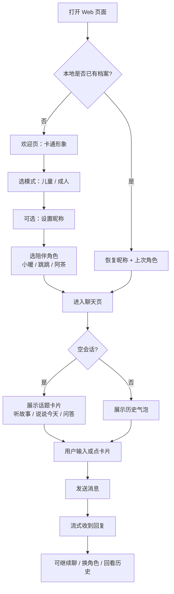

### 1.2 单次发消息（含安全）

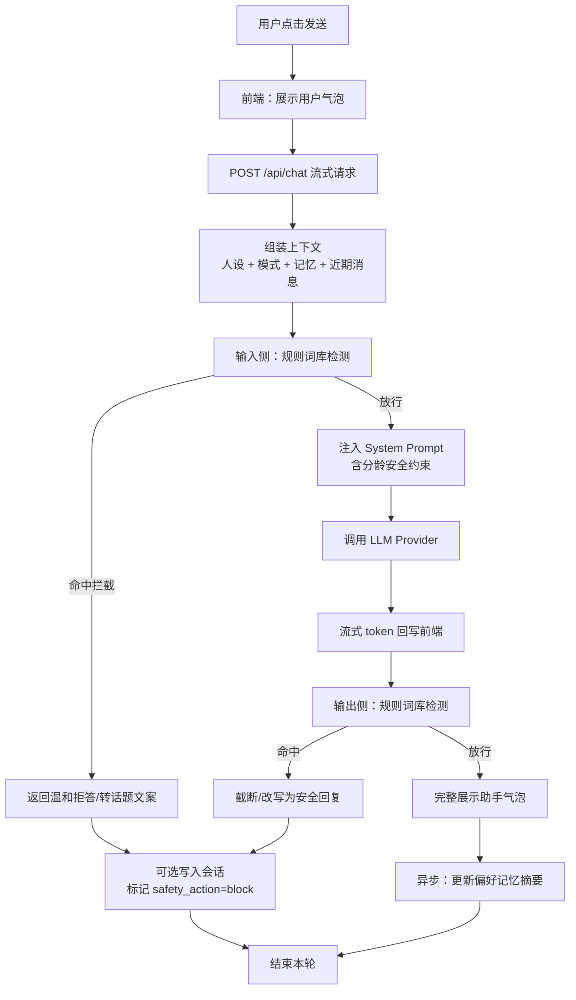

### 1.3 儿童模式 vs 成人模式（决策分支）

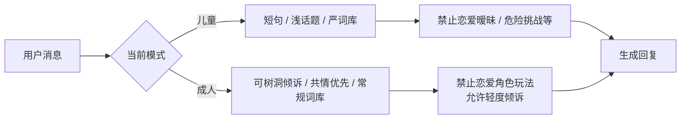

### 1.4 版本演进路线（产品流程视角）

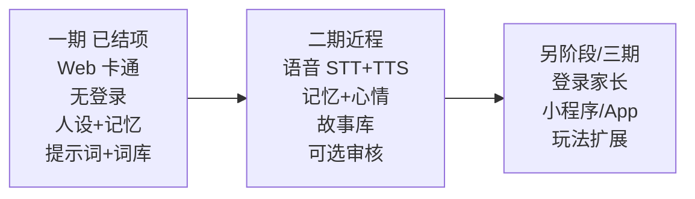

---

## 2. 产品思维导图

### 2.1 总览

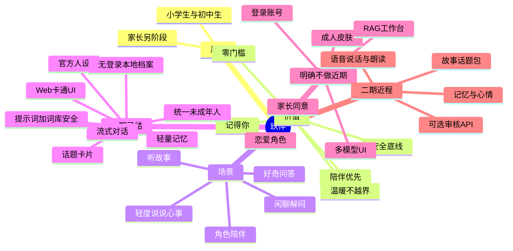

### 2.2 功能模块脑图（研发拆分视角）

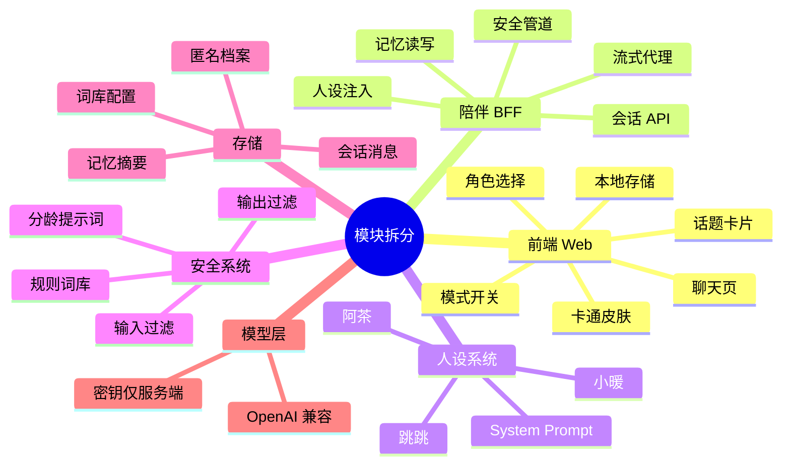

---

## 3. 项目架构图

### 3.1 系统逻辑架构（MVP）

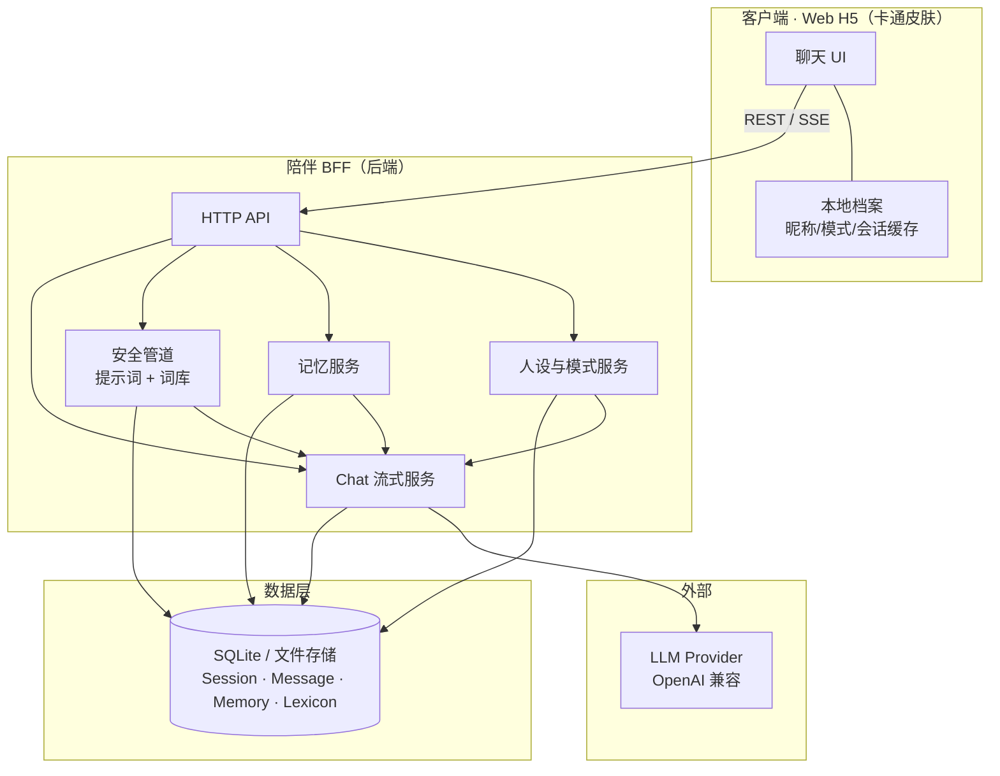

### 3.2 单次请求时序

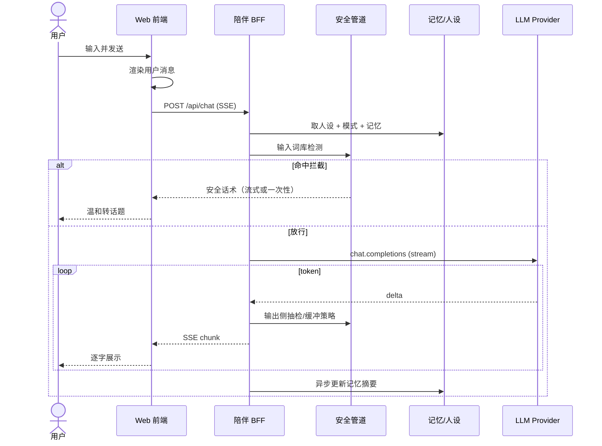

### 3.3 推荐仓库目录结构（落地参考）

> **完整文件级约定（含 PRD 对照、放置规则）**：见 [`docs/directory-structure.md`](./directory-structure.md)。  
> 正式目录名为 **`frontend/`**、**`backend/`**（不再使用计划旧称 `web/`、`server/`）。

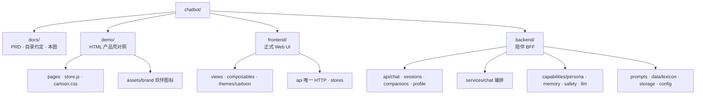

**文字版目录（摘要；细目见 directory-structure.md）：**

```text
chatbot/
├── README.md
├── docs/
│   ├── PRD.md
│   ├── diagrams.md              ← 本文件
│   └── directory-structure.md   ← frontend/backend 文件级约定
├── demo/                        ← HTML 产品壳对照（不接真模型）
├── frontend/                    ← 正式前端（接 BFF；views + api 垂直对齐）
│   └── src/{views,api,composables,components,stores,themes…}
├── backend/                     ← 陪伴 BFF（api → services/chat → capabilities）
│   └── src/{api,services,capabilities,prompts,storage,config…}
├── vendor/                      ← 参考源码，非运行时
└── docker-compose.yml           ← 可选本地起 backend（用户无感）
```

### 3.4 数据关系（概念）

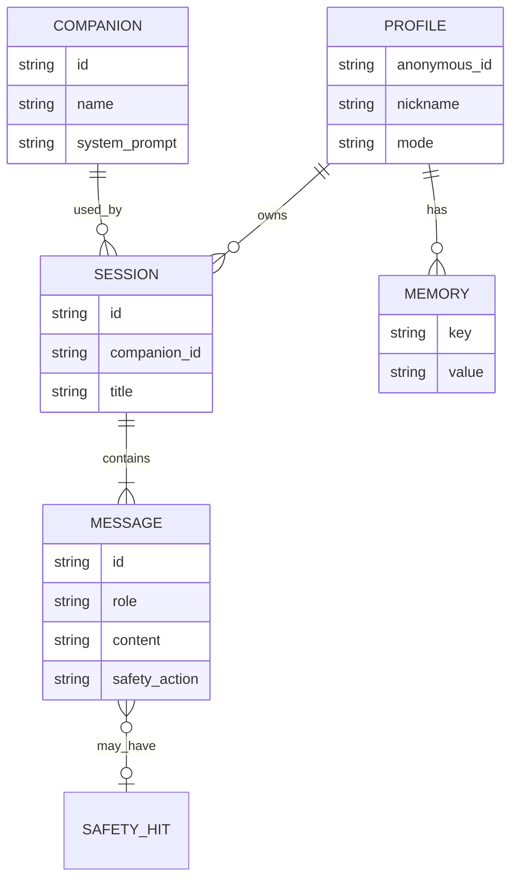

---

## 4. 页面信息架构（简图）

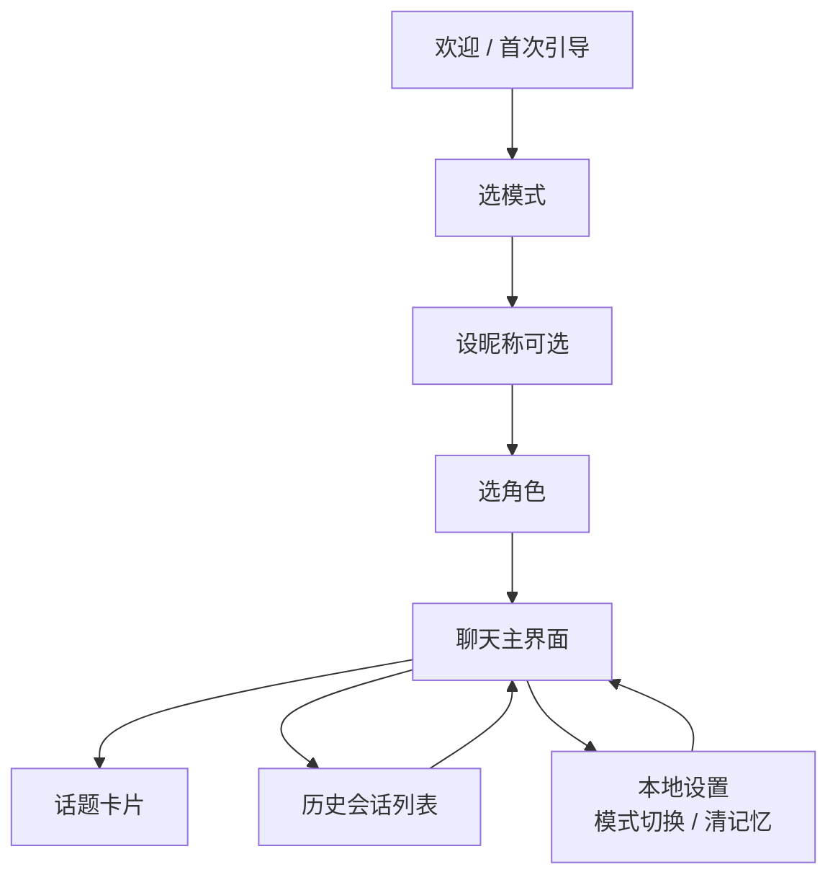

一期**没有**：登录页、家长同意页、模型配置页、恋爱角色页。

---

## 5. 图例说明

| 图 | 用途 |
|----|------|
| §1 流程图 | 产品/研发对齐「用户怎么走、消息怎么过安全」 |
| §2 思维导图 | 范围边界、模块拆分、防范围膨胀 |
| §3 架构图 | 前后端边界、目录落地、数据关系（文件级约定见 `directory-structure.md`） |
| §4 信息架构 | 页面有哪些、没有哪些 |

如需导出 PNG/SVG，可用 Mermaid CLI 或 IDE 插件对上述代码块导出。
