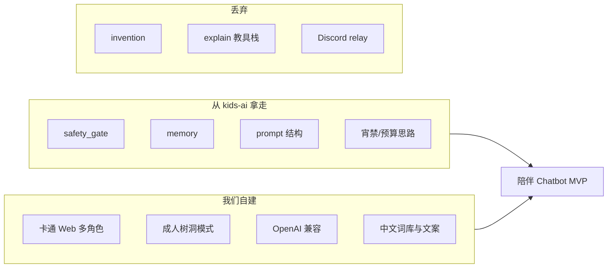

# kids-ai 可行性评估报告

| 项 | 内容 |
|----|------|
| 评估对象 | [yusukebass77/kids-ai](https://github.com/yusukebass77/kids-ai)（已下载至 `vendor/kids-ai/`） |
| 对照文档 | `docs/PRD.md` v0.3、`docs/diagrams.md` |
| 评估日期 | 2026-07-22 |
| **总评** | **不建议整仓作为主产品底座 fork**；**强烈建议抽取安全门 / 记忆 / 提示词结构做移植** |

---

## 1. 一句话结论

kids-ai 是一个**日本家庭自用、儿童向、MIT、可跑通**的陪伴后端 + 巨型单页 PWA。它在**安全门、轻量记忆、宵禁/时长、儿童提示词**上与我们高度同向；但在**语言（日文）、模型绑定（Anthropic）、产品形态（单助手多模式教育工具）、前端形态（7k 行单 HTML）、成人树洞/多角色卡通陪伴**上与 PRD 偏差大。

**改造整仓 ≈ 重写大半；自建 + 抄核心模块更划算。**

| 决策选项 | 建议 |
|----------|------|
| A. 整仓 fork 改成中文陪伴产品 | ❌ 不推荐 |
| B. 自建 MVP，移植 `safety_gate` / `memory` / prompt 骨架 | ✅ **推荐** |
| C. 仅本地跑通体验，不写进主代码 | ✅ 学习用可以 |

---

## 2. 本地代码快照

| 项 | 实测 |
|----|------|
| 获取方式 | GitHub 直连失败；经 `ghproxy.net` 下载 zip 解压 |
| 路径 | `vendor/kids-ai/` |
| 许可 | **MIT**（可商用改造，保留版权声明即可） |
| 规模 | Python ≈ **3941** 行；`server.py` ≈ **1805** 行；`pwa/index.html` ≈ **7149** 行 |
| 栈 | FastAPI + Anthropic SDK + OpenAI（TTS/STT）+ 单文件 PWA |
| 成熟度 | README 自称 **v0.1**，作者家庭日常使用；有 `tests/test_safety_gate.py` |

---

## 3. 与 PRD 对照矩阵

| PRD 要求 | kids-ai 现状 | 契合度 | 改造成本 |
|----------|--------------|--------|----------|
| Web / 移动优先 | ✅ PWA + 平板友好 | 高 | 低（可参考交互） |
| 卡通多角色陪伴 | ❌ 单助手「あい」+ emoji 头像；偏教育工具 UI | 低 | **高**（整页重做） |
| 儿童 / 成人双模式 | ❌ 仅儿童；模式是 chat/explain/story/programming | 低 | 高 |
| 轻度树洞（成人） | ❌ 无；提示词偏苏格拉底式引导学习 | 低 | 中高 |
| 不做恋爱 | ✅ 无恋爱玩法 | 高 | — |
| 无登录 | ⚠️ 按 `child_id` 路由（`/child1`），非账号体系但仍是「预配置儿童」 | 中 | 中（改成匿名档案） |
| 零配置模型 | ❌ 绑定 **Anthropic Claude**；可选 Discord relay | 低 | 中（改 OpenAI 兼容） |
| 提示词 + 词库安全 | ✅ `prompts/` + `lib/safety_gate.py` 规则正则 + 输出守卫 | **很高** | 低（中文化词库） |
| 轻量记忆 | ✅ `lib/memory.py` jsonl；喜好/事件抽取 | **很高** | 低～中 |
| 话题卡片 | ⚠️ 有多模式入口，非 PRD 式「听故事/说说今天」卡片 | 中 | 中 |
| 家长同意（二期） | ⚠️ 有宵禁、日预算、冻结、监控思路；无同意流程 | 中（可借鉴二期） | — |
| 中文产品 | ❌ UI/Prompt/词库/假名注音均为**日文场景** | 低 | **高** |
| 两套皮肤先卡通 | ⚠️ 粉/蓝渐变主题，非角色化卡通皮肤体系 | 中 | 中高 |

**综合契合度：约 40%（工程能力高、产品形态偏差大）。**

---

## 4. 架构解读（值得抄 vs 应丢弃）

```text
┌─────────────────────────────────────────────────────┐
│  pwa/index.html（巨型单页：聊天+讲解+故事+发明+珠算…） │  ← 不建议继承
└───────────────────────┬─────────────────────────────┘
                        │ /api/chat(/stream)
┌───────────────────────▼─────────────────────────────┐
│  server.py（会话编排 + 宵禁/预算/冻结 + 多模式）       │  ← 可学流程，不宜整文件搬
│    ├─ build_system_prompt(人设+记忆snippet)          │  ← 可学
│    ├─ Anthropic / Discord relay                      │  ← 需替换为 OpenAI 兼容
│    └─ output_response_guard_inline                   │  ← 必学
└───────┬───────────┬───────────┬─────────────────────┘
        │           │           │
   safety_gate  memory.py   invention_engine…          ← 前两者移植；后者丢弃
```

### 4.1 强烈建议移植的模块

| 模块 | 路径 | 为什么 |
|------|------|--------|
| 安全门 | `lib/safety_gate.py` | 输入预过滤 / 记忆是否可存 / 输出守卫 / 告警分级；有单测；与 PRD「提示词+词库」同构 |
| 记忆层 | `lib/memory.py` | jsonl、去重、关键词检索、`build_snippet` 注入 system；体量小、好迁 |
| 儿童提示词骨架 | `prompts/chat-kids-v1.md` | 短句、硬护栏、升级家长、冻结话术、记忆槽位——**话术结构可中文化改写** |
| 宵禁/日预算思路 | `server.py` 相关函数 | PRD 二期家长能力可直接借鉴（时区改中国） |
| 安全文档 | `docs/safety_gate_README.md` 等 | 落地 checklist 有参考价值 |

### 4.2 建议丢弃 / 不要带进主仓

| 模块 | 原因 |
|------|------|
| `lib/invention_engine/**` | Pico 硬件发明配方，与陪伴主线无关，体量大 |
| explain 的 Mermaid/KaTeX/Leaflet/3D | 教具向，MVP 不需要 |
| Discord relay | 作者订阅额度技巧，不可作为产品路径 |
| 珠算 abacus / programming 接线检测 | 非目标 |
| 整份 `pwa/index.html` | 7000+ 行难维护，中文卡通重做成本 ≈ 新建前端 |

---

## 5. 关键技术债与风险

1. **模型耦合**：聊天主路径 `anthropic.Anthropic().messages.create`；换成国内/OpenAI 兼容需改 `server.py` 大段逻辑。  
2. **单体前端**：无组件化；改卡通多角色几乎等于重写 UI。  
3. **日文假设**：假名（pykakasi）、汉字年级限制、JST、日文正则词库——迁中文要系统替换。  
4. **`ChildId` 写死字面量**：`safety_gate.py` 里 `Literal["child2", "child1"]`，扩展成人模式要改类型与配置模型。  
5. **安全默认 log-only**：`KIDS_AI_SAFETY_ENFORCE!=1` 时不强制拦截；我们上线儿童模式应默认 enforce。  
6. **上游活跃度**：个人/家庭项目，v0.1；不宜赌长期 merge 上游。  
7. **依赖网络**：本机 GitHub 不稳定；已用镜像落盘，后续更新同样可能受阻。

---

## 6. 工作量粗估（对照 PRD 一期 4–6 周）

| 路径 | 预估 | 说明 |
|------|------|------|
| **Fork kids-ai → 对齐 PRD** | **5–8 周** | 中文化 + 换模型 + 拆掉发明/讲解 + 重做 UI + 加成人模式/多角色；期间还在与单体 HTML 搏斗 |
| **自建 + 移植 2 个核心库** | **4–6 周**（与原计划一致） | 按 `diagrams.md` 建 web/server；`safety_gate`/`memory` 改编为中文模块 |
| **仅参考文档不搬代码** | 计划不变 | 提示词与词库自己写，质量取决于投入 |

→ **时间上 fork 并不更快，干净度更差。**

---

## 7. 推荐落地方案（可执行）

### 阶段 0（已完成）

- [x] 代码落入 `vendor/kids-ai/`（只读参考，不作为应用入口）

### 阶段 1（建议下一步）

1. **自建** `server/` + `web/`（或 monorepo），OpenAI 兼容流式聊天。  
2. **移植改编**：
   - `vendor/kids-ai/lib/safety_gate.py` → `server/.../safety.py`（词库改简体中文 + 儿童/成人 scope）  
   - `vendor/kids-ai/lib/memory.py` → `server/.../memory.py`  
3. **重写** 中文儿童/成人 system prompt（结构抄 `chat-kids-v1.md`，内容按 PRD）。  
4. **前端新建** 卡通皮肤 + 多角色 + 话题卡（不要改那份 7k HTML）。

### 阶段 2（可选）

- 从 kids-ai 抄：宵禁、日时长、freeze 话术（家长能力）。  
- 保留 `vendor/kids-ai` 作对照，不合并进发布产物。

---

## 8. PRD 能力覆盖示意



---

## 9. 最终建议

| 问题 | 答案 |
|------|------|
| 拉下来有没有价值？ | **有**，尤其安全与记忆 |
| 能不能当主仓库改？ | **能，但不值** |
| 下一步最合理动作？ | **自建骨架 + 移植 safety/memory（MIT 注明来源）** |

若你确认走「推荐路径」，下一步可直接：初始化项目骨架，并把 `safety_gate` / `memory` 改编进 `server/`。
